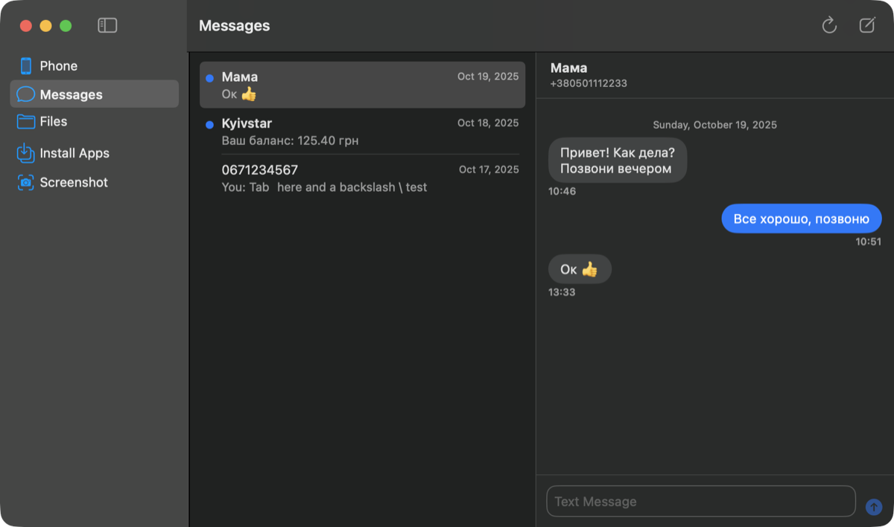
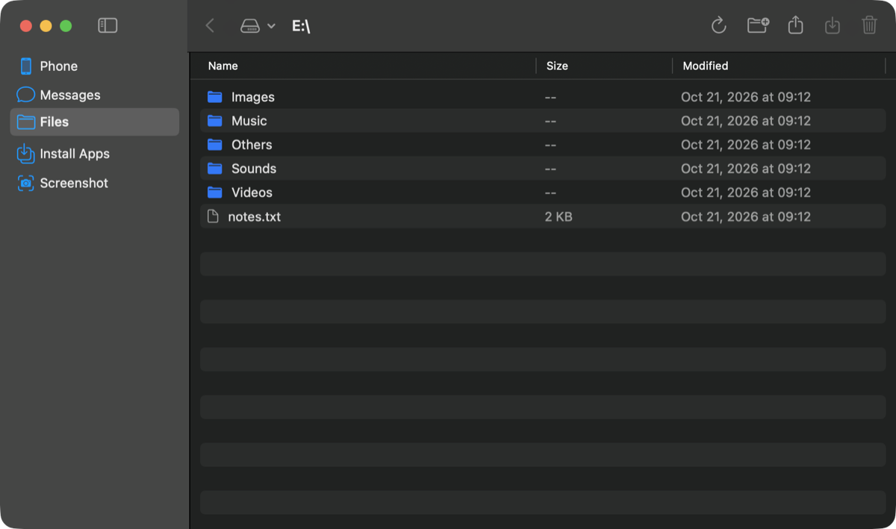
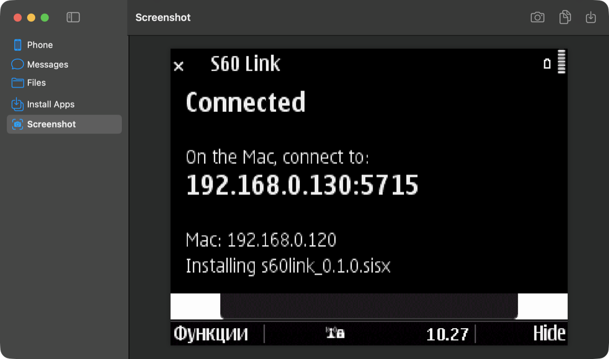
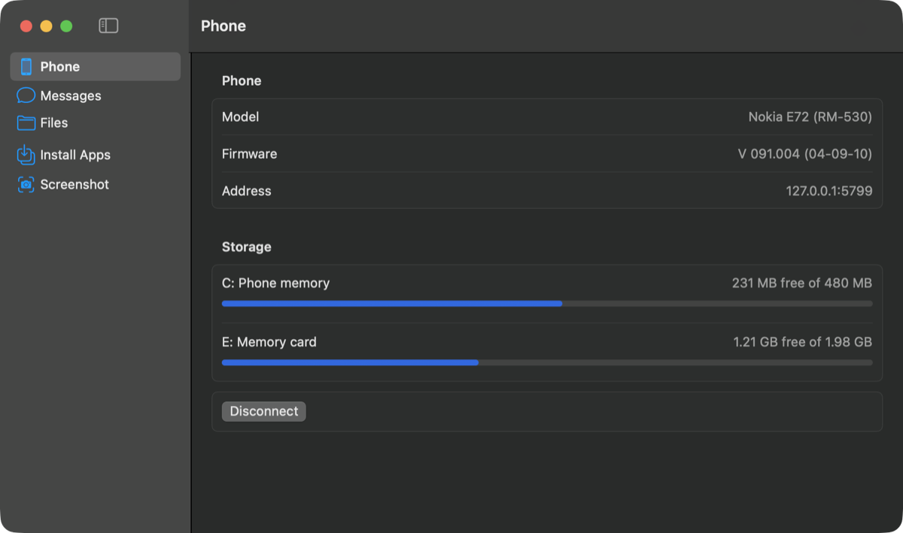
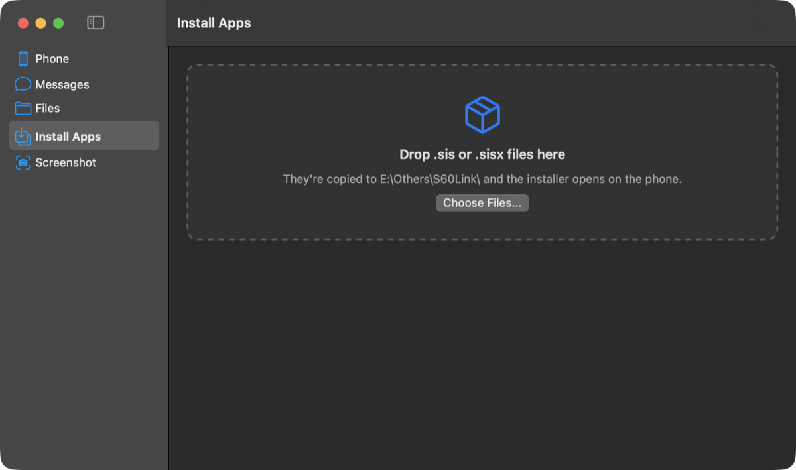
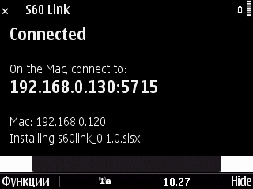

# s60-link

A PC Suite replacement for Nokia S60 3rd Edition phones and macOS. A small app on the phone serves its files and messages over Wi-Fi, and a native Mac app works with them.

Built and tested with a Nokia E72 and macOS 14+.



| Files | Phone screen on the Mac |
|---|---|
|  |  |
| **Phone info** | **Install apps** |
|  |  |

The app on the phone:



## Features

- **Files:** browse the phone memory and memory card, upload by dragging files in, download, rename, create folders and delete.
- **Install apps:** drop `.sis`/`.sisx` files on the Mac app and the installer opens on the phone.
- **Messages:**
  - Text conversations with chat bubbles, unread markers, and names from the phone's contacts.
  - Send texts with a live SMS part counter. Cyrillic and other Unicode text count correctly.
  - Copy or delete messages.
- **Screenshot:** capture the phone's screen and save it as a PNG.
- **Phone info:** model, firmware, and free space per drive.
- **Finding the phone:** connect by address, or let the Mac app scan your Wi-Fi for the phone.

## Using it

1. Install `s60link.sisx` on the phone and open **S60 Link**. Choose your Wi-Fi network, and it shows an address like `192.168.1.23:5715`.
2. Open **S60 Link.app** on the Mac (right-click → Open the first time) and allow local network access.
3. Click **Find Phone on Wi-Fi**, or type the address.

The phone app keeps running when you hide it with the right soft key.

The phone package requests the ReadDeviceData and AllFiles capabilities, for screenshots and for browsing every folder. Self-signed packages with those only install on phones that allow it.

## Building

**Phone app:** it builds inside the [SymbianApps](https://github.com/RuhanSA079/SymbianApps) toolchain. Set up the S60 3rd Edition SDK as described in that README, then:

```sh
git clone https://github.com/denisilin-developer/s60-link apps/s60link
SYM_SDK=s60v31 ./sym sh env/build.sh apps/s60link    # -> out/s60link_s60v31.sisx
```

**Mac app:** needs the Xcode Command Line Tools and macOS 14+.

```sh
cd mac && ./build-app.sh    # -> mac/build/S60Link.app
```

## Protocol and tests

The phone listens on TCP port 5715. Each request is one tab-separated line, such as `LS\tE:\Images\`. The phone answers `OK\t<length>\n` followed by the body, or `ERR\t<message>\n`.

`tests/mock_phone.py` is a fake phone that speaks the same protocol. `mac/.build/debug/s60link-check 127.0.0.1 <port>` runs every command against it, including uploads and downloads, texts, timeouts and error recovery.

## License

MIT.
